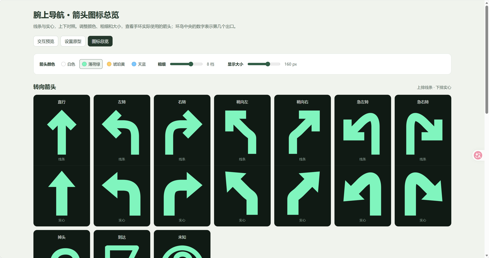

# 腕上导航 · 手机与小米手环导航同步
本项目用于学习、研究与技术交流；许可范围以 [MIT 许可证](LICENSE) 及第三方组件各自许可为准。如有问题，请联系当前维护者 **worlt**：[2516930419@qq.com](mailto:2516930419@qq.com)。

把 Android 高德地图的导航通知同步到小米手环 10 Pro，在手腕上查看转向和完整指引。

> **当前正式 Latest：v0.5.2，配套手机0.4.3/code28与手环0.5.2/code26。** 手机更新页分区/版本对照/折叠详情，同时修复随手机打开与正常返回退出的双振提醒；需双端配套更新。见[发布说明](docs/releases/v0.5.2.md)。

个人开发项目，与高德、小米或AstroBox无隶属关系。仅小米15+9Pro、K80Ultra+10Pro两组有用户真机正常反馈；其他米系预期兼容但未逐型号验证，**其他品牌手机不保证可用**。最新手机UI、每版所有功能/固件与耗电不能据此视为已验收，见[声明](DISCLAIMER.md)。

以下版本介绍为历史，不改变当前下载入口。

**v0.4.7 修复后台退出：** 回桌面、切到高德或其他应用时继续同步，仅在主页面返回退出时按退出开关联动关闭手环。手机更新到 0.3.1/code16；手环 0.4.6 的完整字体与无字体两版沿用原包，本版修复尚未真机验收。详见 [后台与退出修复](docs/phone-background-exit-031.md)。

**v0.4.8 新增手机同步诊断：** 首页默认折叠，只占一行；展开查看读取文字、解析、发送与手环确认，支持复制。手机升到0.3.2/code17，手环0.4.6可沿用；本版诊断尚待真机验证，未声称修复一加不同步。见[诊断说明](docs/phone-diagnostics-032.md)。

**本地刷新候选手机0.3.4 / 手环0.4.7：** 活动导航约每1秒补读通知，手环唤醒请求新读取，先确认接收再更新页面，并减少相同箭头等重复赋值；新增页面数据更新报告。保留此前直行补读，完整优化需双端更新。已通过本地测试和原签名构建，尚未真机验收/发布；1秒补读不代表端到端或息屏实时显示。见[刷新候选说明](docs/navigation-realtime-047.md)。此前[手机0.3.3候选](docs/phone-custom-notification-033.md)保留为历史记录，ColorOS16流体云直行可读仍待实机验证。

## 开发分支与正式源码

开发分支 `preview/band9-band10-compat` 完成检查后，以普通快进合入 `main`，正式标签从 `main` 发布。历史 Preview 与正式 Release 保留，不覆盖标签或附件，不做强推。本地未提交工作不属于本次发布，不会被合并或丢弃。

## 真机测试范围与品牌兼容

仅在 **小米 15 + 小米手环 9 Pro**、**K80 Ultra + 小米手环 10 Pro** 两组组合获得用户真机测试正常反馈。

其他米系手机通常预期能运行，但未经逐型号验证。**其他品牌手机不一定能用，不保证可用**；可能受运动健康互联、通知样式或后台策略影响。

这不代表本模拟页、所有功能、每次新版或所有固件均已通过真机验收。

## 退出联动与杀后台

开启“退出手机应用时退出手环”后，直接杀掉或清理手机后台，进程可能没来得及向手环发送退出通知，因此手环无法跟随退出。从手机主页面正常按返回键或返回手势退出，有用户正常使用反馈；只关闭设置弹层不触发手环退出。强停、断连和系统回收同样不保证退出。

## 来源与原作者

本仓库是以下原项目的修改版，改动说明见 [更新记录](CHANGELOG.md)：

- 原项目：[Gu-Mie/wrist-navigation](https://github.com/Gu-Mie/wrist-navigation)
- 原作者：Gu-Mie
- 原作者联系方式：[2858005527@qq.com](mailto:2858005527@qq.com)

本仓库保留原作者及贡献者的版权声明，本 fork 修改部分保留 worlt 及贡献者的声明，详见 [LICENSE](LICENSE)。字体和第三方 SDK 适用各自许可，见 [第三方声明](THIRD_PARTY_NOTICES.md)。本 fork 的改动和演示站由本仓库维护者负责。

[在线演示](https://wrist-navigation-seven.vercel.app/) · [下载安装包](https://github.com/worlt/wrist-navigation/releases) · [首次使用](docs/getting-started.md) · [开发指南](docs/development.md) · [更新记录](CHANGELOG.md) · [隐私说明](PRIVACY.md) · [项目与使用声明](DISCLAIMER.md)



上图由维护者提供，展示浏览器中的箭头总览，并非真机截图。旧版截图文件保留在仓库中。

## 在线演示

- [箭头图标总览](https://wrist-navigation-seven.vercel.app/)：调整颜色、粗细和大小，对比线条 / 实心，查看环岛出口序号示例。
- [手环交互预览](https://wrist-navigation-seven.vercel.app/preview.html)：用当前页面代码模拟导航、等待和设置场景。
- [设置设计原型](https://wrist-navigation-seven.vercel.app/settings.html)：独立的早期设计原型，样式和字体呈现不完全等同于当前手环界面。

**演示声明：** 网站使用虚构数据，只用于展示；不会连接手机或手环，也不能用于真实导航。浏览器预览不等于 Vela 模拟器、真机验证或已发布安装包，演示版本可能先于 Release。预览设置保存在当前浏览器；访问网站需要连接 Vercel，托管方的数据处理见 [隐私说明](PRIVACY.md)。源码预览内嵌字体和图片，首次打开比首页加载更多资源。

## 手机页面模拟

站点新增 [手机首页与软件更新模拟](https://wrist-navigation-seven.vercel.app/phone.html)：支持明暗主题、版本对照、独立折叠详情/Preview/自动检查及网络失败/未知手环场景。页面为离线虚构演示，不连接设备、不真实检查或安装。`site/phone.html` 随源码生成提交，Vercel从GitHub main拉取；未核对线上前不代表已部署。

## 功能

- **v0.5.2 手机联动双振修复**：随手机打开和正常返回退出时各双振，遵守双端振动开关、去重，退出先ACK并留出双振时间；强杀手机不能保证退出或振动。新提醒需手机043与手环052配套，尚待本版真机震感确认。

- **手机折叠诊断**：四个同步阶段分别显示，保留通知字段来源及消息编号；旧确认不冒充当前确认，可复制当前诊断。仅内存保留，用户点击才复制。

- **v0.4.7 手机后台退出修复**：手机 0.3.1 保留两个独立、默认关闭的打开/退出联动开关。回桌面、切高德或其他应用继续后台同步；主页面返回退出才按退出开关请求关闭手环。可沿用手环 0.4.6，迟到打开仅在明确退出后补偿；尚待本版真机验证。

- **0.4.6 双振提醒（累积 0.4.1–0.4.5 的改动）**：开始、结束、转向、临近、暂停同步和确认断连各振两下，重复事件不重振；有手环总开关、轻柔/明显两档和试振。开始与首条转向合并，断连由手环App本地提醒；完整功能需手机0.3.1和手环0.4.6。此前基本振动成功已获用户反馈，新事件、双振与后台/耗电待实测；系统接口不能直接调马达幅度。

- 查看转向箭头与完整高德通知，长内容可滚动；保留无法识别的原文，不计算或编造路线。
- 高德开始导航时请求打开手环页面，按一次导航控制，减少重复抢回前台。
- 导航页在前台、指引有效时可保持亮屏；结束、断连、过期或离开页面后释放，手机端可关闭此功能。
- 手环完整版可选择系统默认、宋体、楷体、圆体；无字体版仅使用系统字体。两版均可调整字号、文字颜色、箭头大小、粗细、箭头颜色与箭头样式（线条 / 实心，四色），自动保存并支持恢复默认。
- 0.4.0 默认箭头 160px，可调 32–232px；压缩图片留白和图文间距，最大字号配最大箭头仍保留两整行文字。环岛只显示通知明确给出的出口序号，不按序号猜测实际出口方向。
- 等待页按「等待连接、已连接、等待导航、手机端未就绪、手机端未安装」等状态给出不同提示。
- 手机端提供同步开关、连接授权与后台运行设置。

**新增实验候选手机0.3.6 / 手环0.4.8：** 首页分别「检查手机更新」「检查手环更新」，两组自动检查与Preview勾选独立，默认不接收实验提示。手环应用报告当前版本，旧版/未连接显示未知、不误报升级。继续保留直行补读/距离刷新优化，双端配套，两RPK二选一，不自动安装；尚未本版真机验收。[v0.4.9-preview.1 已发布为Pre-release](https://github.com/worlt/wrist-navigation/releases/tag/v0.4.9-preview.1)，[构建安全修复](docs/picomatch-maintenance-20261118.md)及最终标签各8组CI全部通过，七附件匿名下载字节核对通过；正式Latest v0.4.8附件保持。匿名更新API可能限流，手机/真机网络尚未验收。见 [发布说明](docs/releases/v0.4.9-preview.1.md) 和 [交接摘要](HANDOVER.md)；详见 [双端更新](docs/phone-band-updates-036.md)。

## 下载与安装

从 [`v0.5.2（Latest）`](https://github.com/worlt/wrist-navigation/releases/tag/v0.5.2) 下载以下附件，**请先读 TESTING.txt 和发布正文，再核对 SHA256SUMS.txt，本次联动振动修复需双端配套更新**。

| 文件 | 用途 |
| --- | --- |
| `NAV-PHONE-043.apk` | 手机 0.4.3 / code28，更新界面与联动打开提醒 |
| `NAV-BAND-052.rpk` | 手环完整字体版 0.5.2 / code26，联动打开/退出双振 |
| `NAV-BAND-052-NOFONT.rpk` | 手环无字体版 0.5.2 / code26，推荐先用，与完整版二选一 |
| `update.json` | 手机/手环真实版本与附件信息；同次Release元数据 |
| `SHA256SUMS.txt` | 校验APK、RPK、元数据、测试说明与许可 |
| `TESTING.txt` | 真机测试范围、退出限制及待验证项目 |
| `THIRD_PARTY_NOTICES.txt` | 完整版权、MIT、字体OFL与Apache/Gradle许可 |

原包名与配对签名不变，可覆盖同一 fork 的旧签名版本；不能与原作者或其他签名的包混用。APK/RPK 仍为签名 debug 构建，Latest 不改变构建类型。安装到手机的是 APK，安装到手环的是 RPK。

**手环两版二选一**，均通过 AstroBox「快应用」安装，使用同一手机 `NAV-PHONE-043.apk`；本次更新手机0.4.3与手环0.5.2配套。无字体版移除字体选择入口，设置底部标注“无字体版”，保留字号、颜色、箭头和振动等功能。两版共用包名、签名及版本号，不能并存；同版本覆盖是否允许取决于安装工具和固件，如被拒绝，卸载手环应用后重装会清除手环设置，互联授权也可能需要重新确认。无字体版尚未真机验收，详见 [两版区别与构建说明](docs/wearable-variants.md)。

安装后恢复小米运动健康连接，打开手机腕上导航，授予通知使用权、设备权限及互联授权，开启同步，再在高德开始导航。手环振动总开关默认开启，可选轻柔/明显两档并试振；手机进出联动两个开关默认关闭。**手机 0.3.1 及以后开启退出联动后也可正常切后台；仅主页面返回退出时联动关闭手环。历史手机 0.3.0 需关闭该开关才能持续后台导航。** 更多步骤见 [首次使用](docs/getting-started.md)。

此前 [v0.4.0](https://github.com/worlt/wrist-navigation/releases/tag/v0.4.0) 配套手机 0.2.5 / 手环 0.4.0，[v0.2.5](https://github.com/worlt/wrist-navigation/releases/tag/v0.2.5) 配套手机 0.2.5 / 手环 0.3.3，历史附件保持不变。降级可能需要卸载并重新授权，会丢失设置；请勿重置手环或混装不同签名。

## 使用教程

按以下顺序操作最稳：

1. 小米运动健康开着（或已连接，不一定要前台）
2. 手环的「腕上导航」打开
3. 手机的「腕上导航」打开一次，看一眼是否为「已就绪 · 等待导航」
4. 高德开始导航
5. 回桌面 —— 腕上导航的前台服务会接管，手机可以锁屏

顺序的关键点有两个：先让手环链路和通知监听就位，再开始导航。因为导航一旦开始，高德的通知马上就来；虽然监听连上的瞬间会立刻补读一次当前活动通知，但先就位会更稳，不会出现手环先显示「等待导航」再跳转。

非第一次使用可不打开手环的「腕上导航」：打开手机端和高德地图直接开始导航，也能唤醒手环的导航页，只是可能比较慢，并且需要手动亮一下手环屏幕才能持续常亮；是否自动唤醒可在手机端「导航偏好」中设置。

## 适用范围与测试状态

- **行程摘要（剩余时间 / 剩余路程 / 全程里程）未实现**：高德地图通知原文里没有这些字段，解析规则提取不出来，因此手环只显示转向指引与通知原文；更新记录里也没有对应条目。
- 手机最低 Android 8.0（API 26），需要高德地图及小米运动健康；真机组合与品牌范围以上方“真机测试范围与品牌兼容”为准。
- 目标设备为小米手环 10 Pro（336 × 480 面板），已有 0.3.3 使用记录及当前 0.4.0 的维护者试用反馈。9 Pro 与 10 Pro 面板相同、布局代码共用；最新用户反馈两组组合正常，但不能扩展到所有固件和新版功能。其他穿戴设备未验证。
- 需要手机保持导航与连接，不支持独立定位、路线规划或脱离手机导航。常亮仅用于导航页前台，不是系统 AOD。
- 手环 0.3.3 曾在小米手环 10 Pro 日常使用；0.2.4 是此前在 9 Pro 上确认可用的版本。当前 0.4.0 的试用反馈不代表全部项目逐项通过：字体实际加载、所有显示设置、长时间锁屏、重启恢复、ACK 回程及耗电尚未逐项验收。
- 手机 APK 0.4.3 由本仓库自建，与手环 RPK 使用同一签名证书（`0B:6E:D8…:94`），Release 发布正文提供附件的 SHA-256 可核对；本地检查不能替代真机验收，见 [验证摘要](docs/navigation-verification.md)。
- 三款附加字体使用 OFL 1.1，已做子集并改名、保留版权与许可；系统默认字体由设备提供。许可允许按条件随项目使用和分发，但不代表当前固件一定能正确加载，详见 [字体使用与验证](docs/fonts.md)。

## 本地开发

安装 Node.js 22+（推荐 24），在项目根目录运行：

```sh
npm test
npm run dev
```

根目录无需安装 npm 依赖，也无需手机、手环、签名或 Android SDK。打开 <http://127.0.0.1:4173/> 操作源码交互预览；`/index.html` 为箭头总览，`/settings.html` 为设置原型。`npm run site` 生成已纳入 Git 的 `site/`，其中首页为箭头总览；`npm run check:site` 检查页面与当前源码一致。Vercel 直接发布该目录，现有项目关联本仓库的 `main` 后可随推送自动更新，无需删除重建。原生接口由浏览器模拟，构建和部署步骤见 [开发指南](docs/development.md)。

```text
android/       Android 手机应用及单元测试
wearable/      Vela 手环应用、字体、图标及测试
tools/         开发、预览、构建检查与验证工具
docs/          安装、开发、实现与验证文档
licenses/      第三方许可文本
.github/       CI、Issue 与 PR 模板
```

`outputs/`、`.local/`、签名、SDK AAR 和依赖缓存不进入源码仓库。文件公开范围与维护方法见 [发布说明](docs/open-source-release.md)。

## 反馈与许可

欢迎提交 [Issue](https://github.com/worlt/wrist-navigation/issues) 或小范围 PR，先阅读 [贡献指南](CONTRIBUTING.md)。当前维护者：**worlt**；联系邮箱：[2516930419@qq.com](mailto:2516930419@qq.com)。安全问题请按 [安全说明](SECURITY.md) 私下反馈。
