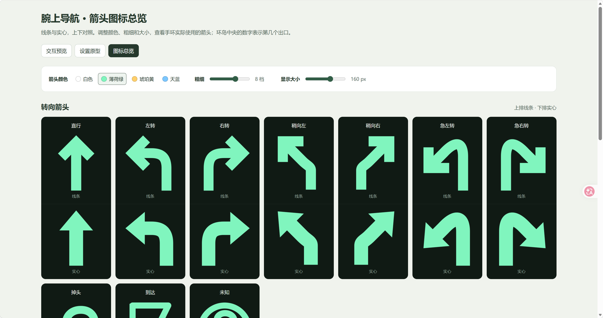

# 腕上导航 · 小米手环 10 Pro
本项目用于学习、研究与技术交流；许可范围以 [MIT 许可证](LICENSE) 及第三方组件各自许可为准。如有问题，请联系维护者邮箱 2516930419@qq.com。

把 Android 高德地图的导航通知同步到小米手环 10 Pro，在手腕上查看转向和完整指引。

个人开发的实验性项目，与高德、小米或 AstroBox 无隶属关系。当前源码为**手机 0.2.5 / 手环 0.4.0**；下方安装指南对应已发布的**手机 0.2.5 / 手环 0.3.3**。手环 0.4.0 已完成本地构建与预览检查，尚未进行本轮真机验收。目标设备为**小米手环 10 Pro**，实际联调手机为**红米 K80 Ultra**。9 Pro 的可用性见下文「适用范围与测试状态」。

## 来源与原作者

本仓库是以下原项目的修改版，改动说明见 [更新记录](CHANGELOG.md)：

- 原项目：[Gu-Mie/wrist-navigation](https://github.com/Gu-Mie/wrist-navigation)
- 原作者：Gu-Mie
- 原作者联系方式：[2858005527@qq.com](mailto:2858005527@qq.com)

本仓库保留原作者及贡献者的版权声明，本 fork 修改部分保留 worlt 及贡献者的声明，详见 [LICENSE](LICENSE)。字体和第三方 SDK 适用各自许可，见 [第三方声明](THIRD_PARTY_NOTICES.md)。本 fork 的改动和演示站由本仓库维护者负责。

[在线演示](https://wrist-navigation.vercel.app/) · [下载安装包](https://github.com/worlt/wrist-navigation/releases) · [首次使用](docs/getting-started.md) · [开发指南](docs/development.md) · [更新记录](CHANGELOG.md) · [隐私说明](PRIVACY.md)



上图由维护者提供，展示浏览器中的箭头总览，并非真机截图。旧版截图文件保留在仓库中。

## 在线演示

- [箭头图标总览](https://wrist-navigation.vercel.app/)：调整颜色、粗细和大小，对比线条 / 实心，查看环岛出口序号示例。
- [手环交互预览](https://wrist-navigation.vercel.app/preview.html)：用当前页面代码模拟导航、等待和设置场景。
- [设置设计原型](https://wrist-navigation.vercel.app/settings.html)：独立的早期设计原型，样式和字体呈现不完全等同于当前手环界面。

**演示声明：** 网站使用虚构数据，只用于展示；不会连接手机或手环，也不能用于真实导航。浏览器预览不等于 Vela 模拟器、真机验证或已发布安装包，演示版本可能先于 Release。预览设置保存在当前浏览器；访问网站需要连接 Vercel，托管方的数据处理见 [隐私说明](PRIVACY.md)。源码预览内嵌字体和图片，首次打开比首页加载更多资源。

## 功能

- 查看转向箭头与完整高德通知，长内容可滚动；保留无法识别的原文，不计算或编造路线。
- 高德开始导航时请求打开手环页面，按一次导航控制，减少重复抢回前台。
- 导航页在前台、指引有效时可保持亮屏；结束、断连、过期或离开页面后释放，手机端可关闭此功能。
- 手环可选择系统默认、宋体、楷体、圆体，调整字号、文字颜色、箭头大小、粗细、箭头颜色与箭头样式（线条 / 实心，四色），自动保存并支持恢复默认。
- 0.4.0 默认箭头 160px，可调 32–232px；压缩图片留白和图文间距，最大字号配最大箭头仍保留两整行文字。环岛只显示通知明确给出的出口序号，不按序号猜测实际出口方向。
- 等待页按「等待连接、已连接、等待导航、手机端未就绪、手机端未安装」等状态给出不同提示。
- 手机端提供同步开关、连接授权与后台运行设置。

## 下载与安装

从 [GitHub Releases](https://github.com/worlt/wrist-navigation/releases) 获取同一次发布的配套文件（当前为 [`v0.2.5`](https://github.com/worlt/wrist-navigation/releases/tag/v0.2.5)）：

| 文件 | 用途 |
| --- | --- |
| `NAV-PHONE-025-local-0B6ED811.apk` | 安装到 Android 手机（0.2.5 / code 10） |
| `io.github.mi9pro.navigation.debug.0.3.3.rpk` | 通过 AstroBox「快应用」安装到小米手环 10 Pro（0.3.3 / code 13） |

2026-11-05 核对该 Release 的实际附件为上述 APK、RPK（另有 GitHub 自动源码归档）；SHA-256 写在发布正文中，未单独附校验表或第三方声明文件。请同时阅读仓库的 [第三方声明](THIRD_PARTY_NOTICES.md)；手环包内字体随附许可。

安装后恢复小米运动健康连接，打开手机腕上导航，授予通知使用权、设备权限及互联授权，开启同步，再在高德开始导航。详细步骤见 [首次使用](docs/getting-started.md)。更新保留旧设置；安装手环 0.4.0 后，可在设置底部点「恢复默认」使用字号 36、箭头 160、粗细 8、实心薄荷绿箭头和白色文字。上表的 0.3.3 包不包含本轮 0.4.0 箭头与环岛更新。

## 使用教程

按以下顺序操作最稳：

1. 小米运动健康开着（或已连接，不一定要前台）
2. 手环的「腕上导航」打开
3. 手机的「腕上导航」打开一次，看一眼是否为「已就绪 · 等待导航」
4. 高德开始导航
5. 回桌面 —— 腕上导航的前台服务会接管，手机可以锁屏

顺序的关键点有两个：先让手环链路和通知监听就位，再开始导航。因为导航一旦开始，高德的通知马上就来；虽然监听连上的瞬间会立刻补读一次当前活动通知，但先就位会更稳，不会出现手环先显示「等待导航」再跳转。

非第一次使用可不打开手环的「腕上导航」：打开手机端和高德地图直接开始导航，也能唤醒手环的导航页，只是可能比较慢，并且需要手动亮一下手环屏幕才能持续常亮；是否自动唤醒可在手机端「导航偏好」中设置。

## 适用范围与测试状态

- **行程摘要（剩余时间 / 剩余路程 / 全程里程）未实现**：高德地图通知原文里没有这些字段，解析规则提取不出来，因此手环只显示转向指引与通知原文；更新记录里也没有对应条目。
- 手机最低 Android 8.0（API 26），需要高德地图及小米运动健康；实际联调手机为红米 K80 Ultra，其他手机兼容性待验证。
- 目标设备为小米手环 10 Pro（336 × 480 面板），已有 0.3.3 的使用记录；0.4.0 本轮仍待真机验证。9 Pro 与 10 Pro 面板相同、布局代码共用，但自 0.3.3 起未再在 9 Pro 上测试，**是否仍可用未经确认**。其他穿戴设备未验证。
- 需要手机保持导航与连接，不支持独立定位、路线规划或脱离手机导航。常亮仅用于导航页前台，不是系统 AOD。
- 当前手环 0.3.3 已安装于小米手环 10 Pro 并作为日常使用版本；0.2.4 是此前在 9 Pro 上确认可用的版本，此后未再在 9 Pro 上回归测试。字体实际加载、所有显示设置、长时间锁屏、重启恢复、ACK 回程及耗电尚未逐项验收。
- 手机 APK 0.2.5 由本仓库自建，与手环 RPK 使用同一签名证书（`0B:6E:D8…:94`），Release 发布正文提供附件的 SHA-256 可核对；本地检查不能替代真机验收，见 [验证摘要](docs/navigation-verification.md)。
- 三款附加字体使用 OFL 1.1，已做子集并改名、保留版权与许可；系统默认字体由设备提供。许可允许按条件随项目使用和分发，但不代表当前固件一定能正确加载，详见 [字体使用与验证](docs/fonts.md)。

## 本地开发

安装 Node.js 22+（推荐 24），在项目根目录运行：

```sh
npm test
npm run dev
```

根目录无需安装 npm 依赖，也无需手机、手环、签名或 Android SDK。打开 <http://127.0.0.1:4173/> 操作源码交互预览；`/index.html` 为箭头总览，`/settings.html` 为设置原型。`npm run site` 生成可部署到 Vercel 的 `site/`，其中首页为箭头总览。原生接口由浏览器模拟，构建和部署步骤见 [开发指南](docs/development.md)。

```text
android/       Android 手机应用及单元测试
wearable/      Vela 手环应用、字体、图标及测试
tools/         开发、预览、构建检查与验证工具
docs/          安装、开发、实现与验证文档
licenses/      第三方许可文本
.github/       CI、Issue 与 PR 模板
```

`outputs/`、`.local/`、签名、SDK AAR 和依赖缓存不进入源码仓库。文件公开范围与维护方法见 [发布说明](docs/open-source-release.md)。

## 反馈与许可

欢迎提交 [Issue](https://github.com/worlt/wrist-navigation/issues) 或小范围 PR，先阅读 [贡献指南](CONTRIBUTING.md)。维护者联系邮箱：[2516930419@qq.com](mailto:2516930419@qq.com)。安全问题请按 [安全说明](SECURITY.md) 私下反馈。
